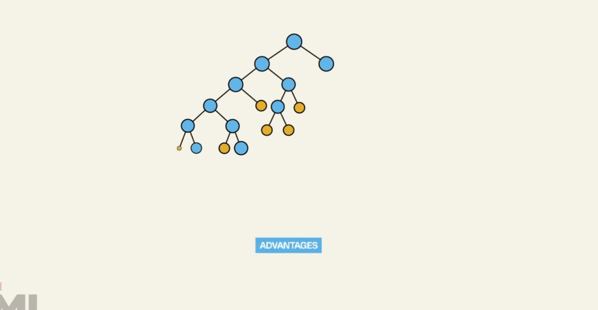
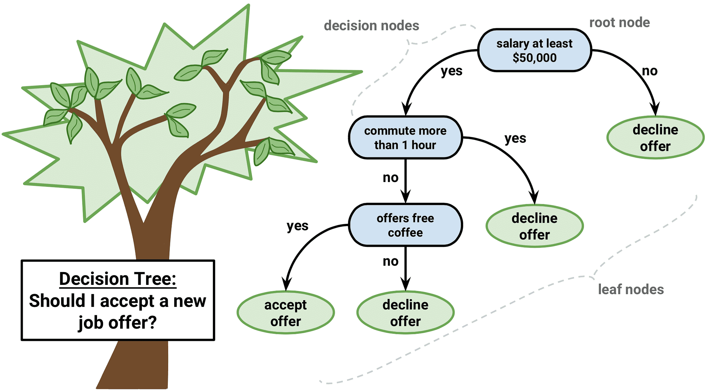

# Decision Tree Algorithm Lecture Notes

Back to [home](https://github.com/yiqiao-yin/pace-u-cs676)

## What is the Decision Tree Algorithm?



- **Overview**: A decision tree is a supervised learning algorithm used for both classification and regression tasks. It works by splitting the dataset into branches based on certain conditions, making predictions at each branch's end.
- **Structure**: The tree consists of nodes, where each internal node represents a decision on an attribute, and each leaf node represents the outcome. This hierarchical structure makes decision trees interpretable and easy to visualize.
- **Applications**: Decision trees are widely used in industries like healthcare, finance, and marketing for their ability to handle both categorical and numerical data.

## How Does the Model Make Splits in the Predictor Space?



- **Splitting Criterion**: The algorithm splits the predictor space by selecting features that maximize information gain or reduce impurity the most. For classification, metrics like Gini impurity or entropy are used, while regression often uses the Residual Sum of Squares (RSS).
- **Binary Splitting**: Each split divides the data into two groups, creating branches in the tree. The process repeats recursively, forming deeper levels of the tree.
- **Stopping Criteria**: The splitting process halts when all data points in a node belong to the same class, or a specified minimum number of samples in a node is reached.

Here's a simple implementation of a decision tree classifier from scratch using NumPy. This implementation focuses on binary classification and uses Gini impurity as the splitting criterion. Please implement at caution. 

```python
import numpy as np

class SimpleDecisionTreeClassifier:
    def __init__(self):
        self.tree = None
    
    def gini(self, y):
        """Calculate the Gini Impurity for a list of labels."""
        prob = np.bincount(y) / len(y)
        return 1 - np.sum(prob ** 2)
    
    def best_split(self, X, y):
        """Find the best feature and threshold to split on."""
        best_gini = float('inf')
        best_idx = None
        best_threshold = None
        
        n_samples, n_features = X.shape
        for idx in range(n_features):
            thresholds = np.unique(X[:, idx])
            for threshold in thresholds:
                left_indices = X[:, idx] <= threshold
                right_indices = X[:, idx] > threshold
                if len(np.unique(y[left_indices])) == 0 or len(np.unique(y[right_indices])) == 0:
                    continue
                    
                left_gini = self.gini(y[left_indices])
                right_gini = self.gini(y[right_indices])
                weighted_gini = (len(y[left_indices]) * left_gini + len(y[right_indices]) * right_gini) / n_samples
                
                if weighted_gini < best_gini:
                    best_gini = weighted_gini
                    best_idx = idx
                    best_threshold = threshold
        
        return best_idx, best_threshold
    
    def build_tree(self, X, y):
        """Build the decision tree recursively."""
        if len(np.unique(y)) == 1:
            return {'label': y[0]}
        
        best_idx, best_threshold = self.best_split(X, y)
        if best_idx is None:
            return {'label': np.bincount(y).argmax()}
        
        left_indices = X[:, best_idx] <= best_threshold
        right_indices = X[:, best_idx] > best_threshold
        return {
            'feature_index': best_idx,
            'threshold': best_threshold,
            'left': self.build_tree(X[left_indices], y[left_indices]),
            'right': self.build_tree(X[right_indices], y[right_indices])
        }

    def train(self, X, y):
        """Fit the decision tree on the data."""
        self.tree = self.build_tree(X, y)

    def predict_sample(self, node, x):
        """Predict a single sample based on the built tree."""
        if 'label' in node:
            return node['label']
        
        if x[node['feature_index']] <= node['threshold']:
            return self.predict_sample(node['left'], x)
        else:
            return self.predict_sample(node['right'], x)
    
    def predict(self, X):
        """Predict class labels for samples in X."""
        return np.array([self.predict_sample(self.tree, x) for x in X])

# Sample Usage
if __name__ == "__main__":
    # Example data
    X = np.array([[2, 3], [1, 2], [3, 6], [6, 7], [5, 8]])
    y = np.array([0, 0, 1, 1, 1])
    
    # Initialize and train our simple decision tree classifier
    clf = SimpleDecisionTreeClassifier()
    clf.train(X, y)
    
    # Make predictions
    predictions = clf.predict(X)
    print("Predictions:", predictions)
```

### Explanation:

- **`gini`:** This function calculates the Gini impurity for a given set of labels.
  
- **`best_split`:** This method searches for the best feature index and threshold to split the dataset that results in the lowest Gini impurity.

- **`build_tree`:** This recursive function builds the decision tree by partitioning the data at each step of recursion based on the best splits found.

- **`train`:** This method fits the decision tree model to the training data.

- **`predict_sample`:** Given a single data point, this method follows the tree structure to predict the label.

- **`predict`:** This function takes in multiple data points and outputs their predicted labels. 

This classifier is a simplistic version of a decision tree and may not handle all edge cases or provide the performance optimizations seen in more advanced libraries like scikit-learn.

## Using RSS as the Main Loss Function to Fit a Decision Tree

- **Residual Sum of Squares (RSS)**: For regression tasks, the decision tree minimizes the RSS at each split. RSS measures the discrepancy between actual and predicted values by summing the squared differences.
- **Fitting the Model**: The model starts with the entire dataset and calculates the potential RSS reduction for each feature and split point. It selects the split that yields the highest RSS reduction.
- **Recursive Process**: This process is repeated recursively, creating splits until the stopping criteria are met, like reaching a maximum depth or a minimum number of samples in a node.

```python
# Example: Using RSS in regression
from sklearn.tree import DecisionTreeRegressor

# Sample data
X = [[1], [2], [3], [4], [5]]
y = [2.3, 2.1, 3.8, 4.5, 5.0]

# Fit the decision tree
regressor = DecisionTreeRegressor()
regressor.fit(X, y)

# Predicting
predictions = regressor.predict([[3.5]])
print(predictions)
```

## Python Package for Building Decision Tree Classifier and Regressor

- **sklearn.tree.DecisionTreeClassifier**: This class in the `scikit-learn` library is used to build decision tree classifiers. It supports criteria like Gini impurity and entropy for classification tasks.

```python
from sklearn.tree import DecisionTreeClassifier

# Sample data
X = [[0, 0], [1, 1]]
y = [0, 1]

# Initialize and fit the classifier
classifier = DecisionTreeClassifier()
classifier.fit(X, y)

# Making a prediction
print(classifier.predict([[2, 2]]))
```

- **sklearn.tree.DecisionTreeRegressor**: This class is used for regression tasks and uses RSS as the default loss function.

```python
from sklearn.tree import DecisionTreeRegressor

# Sample data
X = [[1], [2], [3]]
y = [1.5, 2.5, 3.5]

# Initialize and fit the regressor
regressor = DecisionTreeRegressor()
regressor.fit(X, y)

# Making a prediction
print(regressor.predict([[2.5]]))
```

- **Advantages of sklearn**: The `sklearn` library offers a simple and efficient API for building decision trees. It also provides utilities for tuning hyperparameters like `max_depth` and `min_samples_split` to optimize performance.

## Gini Impurity, Worked by Hand

The `gini` function above is three lines of code, which makes it easy to use and easy to
not understand. It is worth doing the arithmetic once.

**Gini impurity is the probability that two items drawn at random from a node have
different labels.** For two classes with proportions $p$ and $1-p$:

$$\text{Gini} = 1 - (p^2 + (1-p)^2)$$

A node where everything is one class has impurity 0 — pick twice, always agree. A 50/50
node is the worst case at 0.5:

```python
import numpy as np

def gini(labels):
    """Gini impurity: the chance two random picks from this node disagree."""
    labels = np.asarray(labels)
    if len(labels) == 0:
        return 0.0
    p = np.bincount(labels, minlength=2) / len(labels)
    return 1.0 - np.sum(p ** 2)

for name, node in [
    ("all one class ", [1, 1, 1, 1]),
    ("8 yes / 2 no  ", [1]*8 + [0]*2),
    ("half and half ", [1]*5 + [0]*5),
    ("1 yes / 9 no  ", [1] + [0]*9),
]:
    y = np.asarray(node)
    p = y.mean()
    print(f"{name}: p(yes)={p:.1f}  Gini = 1 - ({p:.1f}^2 + {1-p:.1f}^2) = {gini(y):.3f}")
```

```
all one class : p(yes)=1.0  Gini = 1 - (1.0^2 + 0.0^2) = 0.000
8 yes / 2 no  : p(yes)=0.8  Gini = 1 - (0.8^2 + 0.2^2) = 0.320
half and half : p(yes)=0.5  Gini = 1 - (0.5^2 + 0.5^2) = 0.500
1 yes / 9 no  : p(yes)=0.1  Gini = 1 - (0.1^2 + 0.9^2) = 0.180
```

Notice that `8 yes / 2 no` and `1 yes / 9 no` are **not** symmetric in impurity — 0.320
against 0.180. Impurity depends on how lopsided the node is, not which class dominates.

### Choosing between candidate splits

A tree does not evaluate impurity once; it evaluates it for every threshold and keeps the
best. "Best" means the lowest **weighted** impurity of the two children, where each child
is weighted by how many rows land in it:

$$\text{weighted Gini} = \frac{n_{\text{left}}}{n}\text{Gini}_{\text{left}} + \frac{n_{\text{right}}}{n}\text{Gini}_{\text{right}}$$

The weighting is the part people skip, and it matters: a perfectly pure child holding two
rows is worth less than a mostly-pure child holding eight. Here are ten patients with one
feature, and every candidate threshold scored:

```python
import numpy as np

def gini(y):
    y = np.asarray(y)
    if len(y) == 0:
        return 0.0
    p = np.bincount(y, minlength=2) / len(y)
    return 1.0 - np.sum(p ** 2)

age   = np.array([22, 25, 29, 31, 35, 41, 46, 52, 58, 63])
label = np.array([ 0,  0,  0,  0,  1,  0,  1,  1,  1,  1])   # 1 = diagnosed

print(f"parent node: {label.sum()} yes / {len(label) - label.sum()} no, "
      f"Gini = {gini(label):.3f}\n")

for t in [25, 31, 38, 46, 52]:
    left, right = label[age <= t], label[age > t]
    weighted = (len(left) * gini(left) + len(right) * gini(right)) / len(label)
    print(f"age <= {t:<3}  left ({len(left)}, {gini(left):.3f})  "
          f"right ({len(right)}, {gini(right):.3f})  weighted = {weighted:.3f}")
```

```
parent node: 5 yes / 5 no, Gini = 0.500

age <= 25   left (2, 0.000)  right (8, 0.469)  weighted = 0.375
age <= 31   left (4, 0.000)  right (6, 0.278)  weighted = 0.167
age <= 38   left (5, 0.320)  right (5, 0.320)  weighted = 0.320
age <= 46   left (7, 0.408)  right (3, 0.000)  weighted = 0.286
age <= 52   left (8, 0.469)  right (2, 0.000)  weighted = 0.375
```

`age <= 31` wins with 0.167, down from 0.500 at the parent. Compare it with `age <= 25`:
both produce a perfectly pure left child, but the split at 25 isolates only two rows and
leaves eight messy ones behind, while the split at 31 isolates four and leaves a cleaner
remainder. That difference — **0.167 against 0.375** — is entirely the weighting.

This is exactly the loop you write in the homework. Working these five rows by hand first
makes that exercise much shorter.

---

## A Real Dataset: Breast Cancer Diagnosis

Every example so far has used four or five made-up points. Here is the same algorithm on
a real diagnostic dataset that ships with scikit-learn: **569 biopsies, 30 measurements
each, labelled malignant or benign.** No download required.

```python
from sklearn.datasets import load_breast_cancer
from sklearn.model_selection import train_test_split
from sklearn.tree import DecisionTreeClassifier, export_text

data = load_breast_cancer()
feature_names = list(data.feature_names)
class_names = data.target_names.tolist()          # ['malignant', 'benign']

X_train, X_test, y_train, y_test = train_test_split(
    data.data, data.target, test_size=0.25, stratify=data.target, random_state=42)

tree = DecisionTreeClassifier(max_depth=2, random_state=42)
tree.fit(X_train, y_train)

print(f"rows: {len(data.data)}  features: {len(feature_names)}  classes: {class_names}")
print(f"training accuracy: {tree.score(X_train, y_train):.3f}")
print(f"test accuracy    : {tree.score(X_test, y_test):.3f}")
print()
print(export_text(tree, feature_names=feature_names, class_names=class_names))
```

```
rows: 569  features: 30  classes: ['malignant', 'benign']
training accuracy: 0.958
test accuracy    : 0.909

|--- worst radius <= 16.80
|   |--- worst concave points <= 0.14
|   |   |--- class: benign
|   |--- worst concave points >  0.14
|   |   |--- class: malignant
|--- worst radius >  16.80
|   |--- texture error <= 0.47
|   |   |--- class: benign
|   |--- texture error >  0.47
|   |   |--- class: malignant
```

**This output is the reason decision trees are still used.** Four rules, in plain
language, that a clinician can read and argue with: large worst-radius plus high texture
error leans malignant. No other common classifier hands you that. A logistic regression
gives you thirty coefficients; a neural network gives you nothing you can read aloud.
`stratify=data.target` keeps the malignant/benign ratio the same in both halves, which
matters because the classes are not balanced.

### How deep should the tree be?

The single most important knob, and the easiest to get wrong:

```python
from sklearn.datasets import load_breast_cancer
from sklearn.model_selection import train_test_split
from sklearn.tree import DecisionTreeClassifier

X, y = load_breast_cancer(return_X_y=True)
X_train, X_test, y_train, y_test = train_test_split(
    X, y, test_size=0.25, stratify=y, random_state=42)

print("depth   train    test")
for d in [1, 2, 3, 5, 10, None]:
    t = DecisionTreeClassifier(max_depth=d, random_state=42).fit(X_train, y_train)
    print(f"{'None' if d is None else d:>5}   "
          f"{t.score(X_train, y_train):.3f}   {t.score(X_test, y_test):.3f}")
```

```
depth   train    test
    1   0.923   0.923
    2   0.958   0.909
    3   0.977   0.944
    5   0.995   0.937
   10   1.000   0.923
 None   1.000   0.923
```

Read the two columns against each other. Training accuracy climbs all the way to **1.000**
and never looks back — an unconstrained tree can always keep splitting until every leaf
holds a single row, and at that point it has memorised the training set. Test accuracy
peaks at **depth 3** and then *declines*. Everything past depth 3 is the tree learning
noise specific to these 426 training rows.

A training accuracy of 1.0 is not an achievement here; it is the warning sign. This is
the same lesson the homework prints at you.

---

## How Do Decision Trees Compare With Other Classifiers?

A tree is interpretable, but interpretable is not the same as accurate. The honest way to
find out is to run the alternatives on the same data with the same cross validation:

```python
from sklearn.datasets import load_breast_cancer
from sklearn.model_selection import cross_val_score, StratifiedKFold
from sklearn.tree import DecisionTreeClassifier
from sklearn.linear_model import LogisticRegression
from sklearn.neighbors import KNeighborsClassifier
from sklearn.ensemble import RandomForestClassifier
from sklearn.pipeline import make_pipeline
from sklearn.preprocessing import StandardScaler

X, y = load_breast_cancer(return_X_y=True)
cv = StratifiedKFold(5, shuffle=True, random_state=42)

models = {
    "Decision tree (depth 3)": DecisionTreeClassifier(max_depth=3, random_state=42),
    "Logistic regression":     make_pipeline(StandardScaler(), LogisticRegression(max_iter=5000)),
    "k-nearest neighbours":    make_pipeline(StandardScaler(), KNeighborsClassifier(n_neighbors=5)),
    "Random forest (100)":     RandomForestClassifier(n_estimators=100, random_state=42),
}

for name, model in models.items():
    scores = cross_val_score(model, X, y, cv=cv, scoring="accuracy")
    print(f"{name:26} {scores.mean():.3f}  +/- {scores.std():.3f}")
```

```
Decision tree (depth 3)    0.924  +/- 0.021
Logistic regression        0.974  +/- 0.017
k-nearest neighbours       0.963  +/- 0.018
Random forest (100)        0.956  +/- 0.012
```

**The decision tree comes last.** That is not a mistake in the setup — it is the honest
result, and it is the most useful thing on this page. A single tree makes hard
axis-aligned cuts, so a smooth boundary like this one is approximated by a staircase. The
logistic regression, which assumes exactly the kind of smooth boundary the data has,
wins by five points.

Two other things in that table are worth reading:

- **The random forest beats the single tree by three points** (0.956 against 0.924), using
  the same kind of tree. Averaging many trees, each grown on a resample, cancels out the
  variance that makes an individual tree brittle — which is why forests, not trees, are
  what people usually deploy. That resampling is the bootstrap from Session 05.
- **The forest has the smallest spread** (±0.012). It is not just more accurate on
  average, it is more consistent across folds.

### One advantage that is real: trees ignore the units

Notice that logistic regression and k-NN above are wrapped in `make_pipeline(StandardScaler(), ...)`
and the trees are not. That is not an oversight. Trees split on thresholds within a single
feature, so rescaling a column changes nothing. Distance-based and coefficient-based
methods care a great deal:

```python
from sklearn.datasets import load_breast_cancer
from sklearn.model_selection import cross_val_score, StratifiedKFold
from sklearn.tree import DecisionTreeClassifier
from sklearn.neighbors import KNeighborsClassifier

X, y = load_breast_cancer(return_X_y=True)
cv = StratifiedKFold(5, shuffle=True, random_state=42)

X_rescaled = X.copy()
X_rescaled[:, 3] *= 10_000        # one column recorded in different units

for name, model in [("Decision tree", DecisionTreeClassifier(max_depth=3, random_state=42)),
                    ("k-NN (no scaling)", KNeighborsClassifier())]:
    original = cross_val_score(model, X, y, cv=cv).mean()
    rescaled = cross_val_score(model, X_rescaled, y, cv=cv).mean()
    print(f"{name:20} original {original:.3f}   one column rescaled {rescaled:.3f}")
```

```
Decision tree        original 0.924   one column rescaled 0.924
k-NN (no scaling)    original 0.935   one column rescaled 0.866
```

The tree is **completely unchanged**. The k-NN loses seven points, because one feature now
dominates every distance calculation. On messy real data where columns arrive in whatever
units someone recorded them in, that invariance saves a preprocessing step you can get
wrong.

### When to reach for a tree

| Reach for a tree when | Reach for something else when |
| --- | --- |
| Someone has to **read and defend** the rules | Only accuracy matters |
| Features are a mix of scales and types | The boundary is smooth (logistic regression often wins) |
| You want a fast, no-preprocessing baseline | You have very few rows and many features |
| You need feature importance quickly | You need calibrated probabilities |

And in practice: **use a single tree to understand your data, then use a random forest or
gradient boosting to predict with it.** The single tree is the explanation; the ensemble
is the product.

---

## Summary

- Decision trees are powerful, interpretable algorithms for classification and regression tasks.
- The splitting process in decision trees is based on maximizing information gain or minimizing impurity.
- For regression tasks, RSS is used as the primary loss function to decide splits and fit the model.
- The `sklearn.tree` module in Python provides easy-to-use classes for building decision tree classifiers and regressors.

## Homework

**[`04_tree.py`](https://github.com/yiqiao-yin/pace-u-cs676/blob/main/notebooks/homework/04_tree.py) — Decision Tree from scratch**

Write the exhaustive search for the best Gini split. The exercise uses the `SimpleDecisionTreeClassifier` from this page unchanged, with synthetic data and a held-out test set, and prints the tree it learned so you can read its rules.

The script is complete apart from the parts you write, and it grades itself, so you
are not guessing whether you got it right. Only numpy is needed. See the
[homework README](https://github.com/yiqiao-yin/pace-u-cs676/blob/main/notebooks/homework/README.md) for setup and the full list of exercises.
